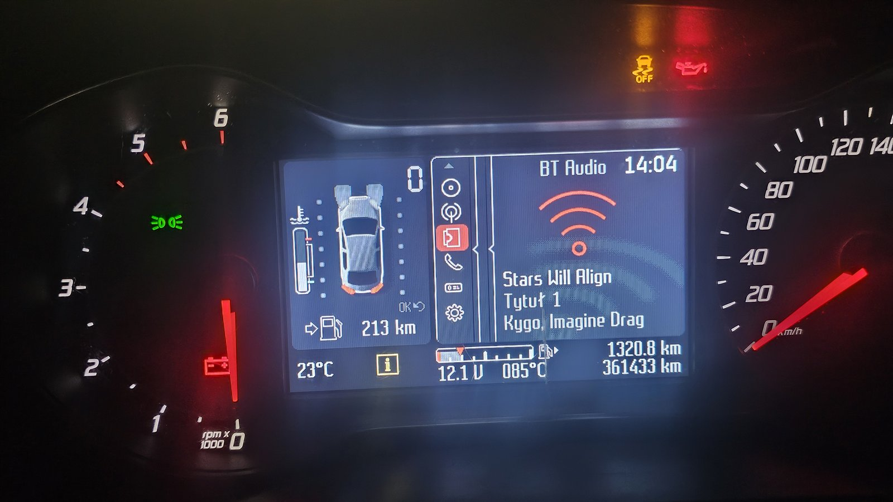

# convers-bt-audio

**Native firmware patch that makes the Ford Convers+ instrument cluster display Bluetooth audio track title & artist — the same way it already does for USB.**

The Convers+ cluster (MCU: NXP **MAC7116**) shows track metadata for USB and CD sources, but the Bluetooth Audio screen stays blank because the firmware never processes the BT metadata CAN messages. This project adds that missing piece **natively in firmware** — no external CAN bridge, no extra hardware, no companion app.

- ✅ Bluetooth track **title** and **artist** now appear on the *BT Audio* screen
- ✅ Reuses the cluster's own, already-working media text pipeline (the USB path)
- ✅ Up to **19 characters** per field — which is exactly the Bluetooth module's own maximum (see [Limitations](#limitations))
- ✅ Robust: oversized or malformed metadata from the phone/BT module cannot overflow anything or crash the cluster
- ✅ Ships as **patch scripts only** — you patch your *own* firmware dump; no Ford binaries are redistributed

> **Confirmed on two cars:** Ford **Mondeo MK4 facelift (FL), 2011+** — Convers+ cluster, firmware **1412-FL** (`CS7T-14C026-CD`); and a Ford **S-Max**, firmware **1412** (`CS7T-10849-VE`), independently verified on the vehicle by [@wojtkowiak](https://github.com/wojtkowiak) ([#1](../../issues/1)). Firmware **15.07** (`CS7T-14C026-CG`) is also confirmed, on the same Mondeo. Other cars/versions that use the same Convers+ cluster may work, but are currently **unverified** (see [Compatibility](#compatibility)).

> ⚠️ **Patched a stock image with the tools from before 2026-10-12? Rebuild and flash again.**
> The cluster checks its own flash in the background, and the older tools left that check failing
> on a factory 14.12 / 15.07 image: the cluster stores DTC **U3000** and, on cars with adaptive
> cruise control, the car reports **"ACC not available"** a few seconds after start. The tools now
> balance the image as their last step. To fix an image you already have, run
> `python tools/apply_render.py patched.bin fixed.bin`, repack and flash — or simply patch your
> original dump again. `python tools/emulate.py --dump patched.bin` tells you whether an image is
> affected (line `FLASH`). Details: [HOW_IT_WORKS.md §15](docs/HOW_IT_WORKS.md).



*Patched cluster on a Ford Mondeo MK4 FL — the BT Audio screen now shows the live track title ("Stars Will Align") and artist ("Kygo, Imagine Dragons") streamed over Bluetooth.*

---

## ⚠️ DISCLAIMER — READ BEFORE YOU DO ANYTHING

**This modifies the firmware of a safety-related vehicle component. You do this entirely at your own risk.**

- **Bricking is a real possibility.** A bad flash can leave your instrument cluster unbootable. Recovery may require JTAG/BDM hardware and is not guaranteed.
- **You will likely void your warranty** and may violate the terms of your vehicle's software.
- **Always keep a verified, complete backup** of your original firmware **and EEPROM** before flashing anything. Store it somewhere safe.
- Your firmware dump **contains your VIN and other vehicle data** — never upload it publicly.
- This is **not affiliated with, endorsed by, or supported by Ford.** "Ford" and "Convers+" are used only to identify the target hardware.
- The authors accept **no liability** for any damage, loss, or injury. If you are not comfortable reading a disassembler and recovering a bricked ECU, **do not proceed.**

If any of the above scares you — good. Stop here.

---

## Compatibility

| Item | Value |
|------|-------|
| **Confirmed vehicles** | **Ford Mondeo MK4 facelift (FL), 2011+** (original test car) · **Ford S-Max** (independently confirmed on the vehicle by [@wojtkowiak](https://github.com/wojtkowiak), [#1](../../issues/1)) |
| Cluster | Ford Convers+ IPC |
| MCU | NXP MAC7116 (ARM7TDMI-S, Thumb, **big-endian**, ARMv4T) |
| Firmware base | `0x5000` |
| **Confirmed firmware** | **1412-FL**, VBF partition `CS7T-14C026-CD` (Mondeo) · **1412**, `CS7T-10849-VE` (S-Max — string as reported by the tester; exact VBF/software part number to be confirmed) · **15.07**, VBF partition `CS7T-14C026-CG` (Mondeo — same car as 1412-FL) |
| **Head unit (confirmed car)** | Blaupunkt **MCA**, with a discrete Bluetooth module (`C7ST-14D212`) that puts the metadata on the CAN bus |
| Other vehicles / versions | **Untested.** Other Fords using the same Convers+ cluster may work. The patch is cluster-side, so what matters is that *some* module (a discrete BT module and/or the head unit) broadcasts the metadata on the bus — and on which ID (see [TESTING.md](docs/TESTING.md); use `--canid` if it differs). The patch scripts verify the exact bytes they expect at each hook site and **abort** if they don't match, so they will refuse to patch an incompatible image rather than corrupt it. |

If you have a different firmware version and the scripts abort, please open an issue with your version string — the offsets can usually be ported.

### Tested against the whole firmware family (2026-09-23)

`tools/check_all.py` was run over the complete set of Convers+ firmware we have — 47 VBFs
(Mondeo, S-Max, Transit, pre-facelift and 2007–2010 clusters) plus the dump of the confirmed car.
For every application image it identifies the version, builds the patch in memory, checks that
nothing outside the hook, the cave, the five renderer sites and the flash self-test balancing word
changes, checks that the two scripts give the same result in either order, checks that the image
still passes the firmware's flash self-test, repacks the VBF, and runs the emulator A/B.

| Firmware (banner) | Image | Result |
|---|---|---|
| **14.12** | `CS7T-14C026-CD` (+ the car dump) | ✅ **supported** — patched on the cars; build byte-identical to the flashed image; emulator A/B PASS |
| **15.07** | `CS7T-14C026-CG` | ✅ **supported** — own table entry; emulator A/B PASS; patched on the car (Mondeo) |
| 14.11 | `CS7T-14C026-CC` | ⏳ not supported yet — same code as 14.12, but its data tables (PERBUS, DLIST, SRAM) are elsewhere; the easiest port |
| 12.18 / 13.02 / 13.04 (Transit) | `BS7T-14C026-CE/CF/CG` | ⏳ not supported yet — same product family (full audio menus incl. *BT Audio*), different addresses; a port needs its own measurements |
| 11.18 / 11.22 (pre-FL) | `AM2T-14C026-CD/CF` | ⏳ not supported yet — as above |
| 10.05 / 10.07 / 10.10 | `8M2T-14C026-CD/CE/CF` | ⏳ not supported yet — as above |
| early 8M2T (`D6.01` / `08.11` / `08.15`) | `8M2T-14C026-CA/CB/ZB` | ❌ no *BT Audio* screen in this firmware (the menu text is absent) — nothing to fix |
| 04.02 / 01.02 (Transit) | `BS7T-14C026-GD/GE` | ❌ no audio screens in this firmware (no audio menu texts) — nothing to fix |
| 512 KB images at `0x780000` / `0x740000`, and `8M2T-14C026-AC/AD/DC/DD` | `…-AC/AD/AE/AF/BC/BD/BE/BF/DC/DD/DE` | not a Convers+ application image (a different memory map, apparently another cluster type with a different MCU) — out of scope |
| GFX, bootloader | remaining VBFs | not an application image — skipped |

"⏳ not supported yet" means the scripts refuse the image today; nobody has measured its table
entry. It does not mean the patch cannot work there.

Every version needs its own measured table entry (`tools/fw_versions.py`); the scripts never
guess, and an image that matches no entry is refused before anything is written.

**Test your own collection** (a folder of `.vbf` and/or `.bin`, searched recursively):
```bash
pip install unicorn
python tools/check_all.py path/to/firmware-folder --json report.json
```
Add `--out DIR` to also save the patched `.bin`/`.vbf` of every supported image.

---

## How it works (short version)

Bluetooth sends track metadata over CAN ID `4B1` (source byte `0x12`), as ISO-TP text frames in the format `[field][source][01][01][text]`. Stock firmware treats `4B1` as a dead 2-byte "signal" and throws the text away.

The patch installs a small code cave hooked into the CAN receive path (**before** the message is dispatched by type), which:

1. reads the raw FlexCAN mailbox and filters for CAN ID `4B1`,
2. reassembles the ISO-TP payload (First / Consecutive / Single frames),
3. feeds the completed text into the **same media dispatcher the USB path uses**, which writes it to the Bluetooth metadata store the screen already reads.

A second, tiny patch to the BT Audio screen renderer relocates one string buffer so title and artist can each be up to 19 characters without one overwriting the other.

Full technical write-up: **[docs/HOW_IT_WORKS.md](docs/HOW_IT_WORKS.md)**.

---

## Requirements

- **Python 3.8+**
- A way to **read and write** your cluster's firmware (e.g. via the bootloader / a VBF flasher). This project does **not** flash for you — it only produces the patched image.
- Optional, for verifying/experimenting: [Capstone](https://www.capstone-engine.org/) (`pip install capstone`) and [Unicorn](https://www.unicorn-engine.org/) (`pip install unicorn`) if you want to disassemble or emulate.

Community resources for dumping and flashing Convers+ clusters can be found on the [microhacker forum](https://microhacker.denkdose.de/).

---

## Usage

> All commands take **explicit file paths**. Nothing is committed to this repo — you work on your own dump locally (see `.gitignore`).

**0. Back up first.** Dump your firmware *and* EEPROM and keep verified copies.

**1. Extract the code partition** from your firmware image (the `0x5000`-based program image). If your dump already is that image, use it directly as `main.bin`.

**2. Apply the CAN patch (BT metadata → media store):**
```bash
python tools/apply_patch_v3.py main.bin main_patched.bin
```
The script recognises your firmware version from the image bytes and checks every anchor before writing. If it says `REFUSED`, your firmware version is not supported (yet) — stop and open an issue with the lines it printed. The two patch scripts may be run in either order.

**3. Apply the renderer patch (19-character fields):**
```bash
python tools/apply_render.py main_patched.bin main_patched.bin
```

**4. Repack into a flashable VBF**, using your original VBF as the template (keeps the correct part number, address and CRCs):
```bash
python tools/vbf_tool.py pack original.vbf main_patched.bin main_patched.vbf
```

**5. Flash `main_patched.vbf`** with your usual tool, then play a Bluetooth track and open the *BT Audio* screen.

---

## Limitations

- **19 characters max** per field — and this is not our limit, it's the **Bluetooth module's**. The module truncates every field to 19 characters *at the source*, before it ever transmits over CAN, so no firmware change on the cluster side can show more (the extra characters never leave the phone/BT module). 19 also happens to be the cluster architecture's own ceiling (the stock field handler and buffers cap there), so the two limits line up perfectly.
- **The `~` truncation marker, and why 18 vs 19 barely matters.** When a title/artist is longer than the module allows, the Bluetooth module sends the first 18 characters followed by a `~` (0x7E) as the 19th, meaning "there's more." The cluster stores that `~` but **does not render the glyph** — it's simply ignored on screen — so e.g. *"Turn the lights off (remix)"* shows as *"Turn the lights of"* (18 characters). A real 19th character is therefore only ever visible when a title is **exactly 19 characters** long; for anything longer the 19th slot is the module's `~`, which isn't drawn. So the 18→19 change is, in practice, marginal — it only recovers that exact-19 edge case.
- Handles **`4B1` only** (not `4B0`). The two carry the same text but interleave at the frame level; processing both corrupts the shared reassembly buffer. `4B1` alone is complete.
- **Robust against bad input.** The reassembly is bounded by a single clamp plus a per-frame guard, so oversized (even 250-char), unterminated, orphaned or garbage frames from the BT module are safely truncated or ignored — they cannot overflow the scratch buffer, corrupt neighbouring fields, or crash the cluster. See [HOW_IT_WORKS.md §11](docs/HOW_IT_WORKS.md).
- **Album** is reassembled too, but many clusters don't show an album field on the BT screen.
- Confirmed on cars with 14.12 (Mondeo, S-Max) and 15.07 (Mondeo); any other version is refused (see Compatibility).

---

## Repository layout

```
tools/
  fw_versions.py       the table of supported firmware versions + image fingerprint (one place for every address)
  apply_patch_v3.py    CAN 4B1 → media store code cave (version auto-detected, refuses unknown images)
  apply_render.py      BT Audio renderer patch (19-character fields)
  vbf_tool.py          VBF pack/unpack (CRC16-CCITT + CRC32)
  make_test_frames.py  generate/send CAN 0x4B1 test frames to verify the cluster
  emulate.py           run the patch on your own dump in an emulator (no car needed)
  check_all.py         run the whole pipeline (detect, patch, repack, emulate) over a folder of firmware
docs/
  HOW_IT_WORKS.md      full reverse-engineering write-up
  FLASHING.md          dump → patch → pack → flash walkthrough
  TESTING.md           prove the patch works by injecting known 0x4B1 frames
```

## Nothing showing from your phone?

**Start with no hardware at all.** You can run the patch on your *own* firmware dump in an emulator and watch a simulated Bluetooth track make it all the way to the BT Audio display — no car, no CAN adapter:

```bash
pip install unicorn
python tools/emulate.py --dump main.bin
```

It patches a throw-away copy exactly the way you'd flash it, injects a `0x4B1` metadata frame, runs the real cluster code, and tells you in plain language whether the title/artist reached the screen — and whether your firmware version is even supported. See **[docs/TESTING.md → emulator](docs/TESTING.md#zero-hardware-run-it-in-an-emulator)**.

Then, on the bench or in the car: the patch displays only what arrives on the bus as CAN `0x4B1`. Before assuming the flash failed, **inject known test frames** to check the cluster side independently — see **[docs/TESTING.md](docs/TESTING.md)**. If an injected title shows up, the patch is fine and the issue is that your Bluetooth source isn't broadcasting `0x4B1`.

**Different head units use different IDs.** Some units (e.g. a Blaupunkt MCA) put Bluetooth metadata on a different CAN ID than `0x4B1`. If a bus capture shows your metadata on another ID, you can retarget the patch with the **experimental** `--canid` option — see [docs/TESTING.md → different CAN ID](docs/TESTING.md#if-your-head-unit-uses-a-different-can-id-experimental).

## Contributing

Issues and PRs welcome — especially ports to other firmware versions (please include your version string and the bytes the scripts report). Please **never** attach firmware dumps or VBF files to issues; they contain Ford code and your VIN.

## Thanks

- **[@wojtkowiak](https://github.com/wojtkowiak)** — the first person outside this project to
  verify the patch independently, and the first to confirm it **on a second car**. After
  rebuilding it against his own dump and verifying it end to end in the Unicorn emulator, he
  flashed it to his Ford **S-Max** (firmware **1412**, `CS7T-10849-VE`), where it works
  ([#1](../../issues/1)). He keeps a JTAG-recoverable bench unit for exactly this kind of work
  and is putting together a dump/flash procedure that needs nothing but a Canable interface.
  The S-Max is now in the [Compatibility](#compatibility) table. His JTAG dump of the cluster
  bootloader also settled a memory-safety question for the sibling
  [convers-gauge-sweep](https://github.com/andrzejogh/convers-gauge-sweep) project — thanks!
  Thanks also for sharing a full cluster emulator, and for preparing the first port of this
  patch to firmware **15.07**. The 15.07 support released here builds on that work; the one
  difference is the SRAM scratch: that port uses `0x40009880`, while we decided to derive the
  location differently and keep the offset inside the stock media-message buffer that is proven
  on the car with 14.12, which gives `0x40009320` on 15.07 (see
  [HOW_IT_WORKS.md §14](docs/HOW_IT_WORKS.md#14-other-firmware-versions)).
- **[@sccsltd](https://github.com/sccsltd)** — for sharing firmware images used to test the patch
  across versions.

## License

[MIT](LICENSE) © 2026 andrzejogh

Not affiliated with Ford Motor Company. Trademarks belong to their respective owners.
